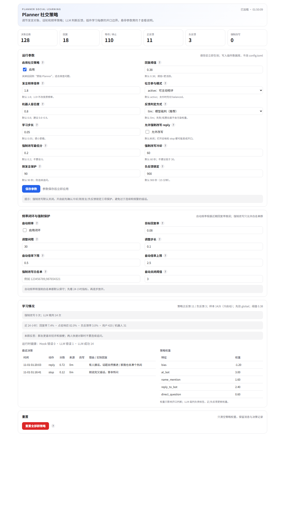

# Planner Social

为 MaiBot 的 Maisaka Planner 提供**发言对象判断、话轮策略、LLM 反馈学习**和可调的发言频率。它是一个独立维护的插件项目，不依赖修改 MaiBot 核心代码。

> 插件 ID：`maibot-team.planner-social`  
> 当前版本：`1.0.1`  
> 许可证：GPL-3.0-or-later

## 它解决什么

群聊里 Planner 常见四类问题：

1. 把别人的“你”当成对机器人说；
2. 两个人快速对聊时插嘴；
3. 机器人刚说完、没人接话时继续追问；
4. 只靠关键词学习，反讽/玩笑/冷场被误判。

本项目用“确定性社交特征 + LLM 反馈裁判 + 每群在线策略 + 可选深度改写”处理这些问题。



## 核心能力

- **Addressee 解析**：多 `@`、昵称/别名、引用链、回复别人、上一条发言者
- **话轮与节奏**：消息密度、两人对聊、刚发言保护、群级阈值
- **LLM 反馈裁判**：`positive / negative / neutral + confidence + reason`，低置信度不污染权重
- **每群独立学习**：10 维可解释 logistic 策略；冷启动 + 跨群先验
- **LLM 群规范反思**：每 N 条反馈总结 1–3 条群规范，注入后续 Planner
- **深度改写**：active 模式下把 `stop/wait` 改成 `reply`（默认关闭，带白名单/冷却/负反馈熔断）
- **频率闭环**：按目标回复率自动微调 `talk_value` 倍率（默认关闭）
- **侧边栏 UI**：所有参数旁有 `?` 悬浮说明；统计、权重、决策、反思、健康状态

## 安装

### 插件市场 / GitHub

仓库：[Mikan-sleep/Maibot-planner-social-improvement](https://github.com/Mikan-sleep/Maibot-planner-social-improvement)

市场按 Git 仓库 + Release tag 识别版本；打 tag 前确认 `_manifest.json` 的 `version` 与 tag 一致
（如 `1.0.1` ↔ `v1.0.1`）。

### 本地构建

```bash
python scripts/validate_plugin.py
python scripts/build_plugin.py
# dist/maibot-team.planner-social-1.0.0.zip
```

把 zip 解压到 `MaiBot/plugins/maibot-team.planner-social/`，或直接把仓库 checkout 到该目录，然后重启/重载插件。

插件首次加载会根据 `PluginConfigBase` 自动生成 `config.toml`；仓库里的 `config.example.toml`
只是参考。**不要把 `config.toml` 提交到 Release 根目录**：插件市场会拒绝包含它的发布版本。

要求：

- MaiBot `1.3.x`
- Python `3.12+`
- 宿主提供 `maibot_sdk`；插件声明 `frequency.*` 与 `llm.generate` 能力

## 首次配置

最常用的配置在侧边栏：**插件扩展 → Planner 社交策略**。

每个参数旁都有 `?`，悬停或键盘聚焦可看“它是什么 + 调高/调低的影响 + 建议范围”。

建议的保守启动：

```toml
[social]
participation_mode = "active"
reply_threshold = 0.38
talk_multiplier = 1.8
bot_tolerance = 0.8
force_reply = false          # 先观察，不要默认深度改写
auto_frequency = false

[learning]
feedback_mode = "llm"
cold_start_min_feedback = 8
reflection_enabled = true
```

`force_reply` 默认关闭是刻意的：0.3.0 实测连续强制回复会导致机器人被群管禁言。要开启时请保留：

- `force_min_utility >= 0.2`
- `force_cooldown_seconds >= 60`
- `force_after_bot_seconds >= 90`
- `force_lock_after_negative_seconds >= 900`
- 用 `force_whitelist` 限定试点群
- 让 `force_auto_disable_after_negatives` 生效

## 架构

```
plugin.py                     Hook / Event / API 编排
planner_social/
├── addressee.py              多 @、别名、引用链
├── features.py               确定性社交信号与 10 维特征
├── policy.py                 每群 logistic 策略、冷启动
├── frequency.py              回复率闭环控制器
├── prompt.py                 Planner 社交状态块
├── config.py                 SDK 配置模型
├── models.py                 数据结构
└── store.py                  SQLite：消息/决策/策略/反思/频率
ui/dashboard.html             自定义侧边栏页面（? tooltip）
webui.json                    WebUI v2 custom page 声明
```

运行数据在 `data/plugins/maibot-team.planner-social/planner_social.sqlite3`，保留期默认 7 天；不写 MaiBot 业务数据库。

## 开发

```bash
python -m venv .venv
# Windows: .venv\Scripts\activate
python -m pip install -e ".[dev]"

ruff check plugin.py planner_social tests scripts experiments
python -m pytest
python scripts/validate_plugin.py
python scripts/build_plugin.py
```

- 测试只依赖标准库；`maibot_sdk` 由宿主提供，不在 runtime 依赖里。
- 修改 `webui.json` 或 `ui/dashboard.html` 后需要重载插件。
- 调试数据/隐私：`docs/design.md`、`docs/development.md`。

## 评估

```bash
python experiments/replay_policy.py \
  --db data/plugins/maibot-team.planner-social/planner_social.sqlite3 \
  --threshold 0.38
```

这是**离线反事实回放**，不是线上 A/B；不能证明因果关系。方法见 [docs/evaluation.md](docs/evaluation.md)。

## 安全与隐私

- `force_reply` 默认关闭；有白名单、冷却、刚发言保护、负反馈锁定、连续负反馈熔断。
- LLM 裁判只发送“被回复消息 + 机器人回复 + 后续必要消息 + 社交信号”，不发送整段历史。
- 可关闭 `store_message_text` 或缩短 `retention_days`。
- 插件异常不会阻塞聊天：Hook 捕获异常并记录健康计数。

## 文档

- [docs/design.md](docs/design.md)：设计依据、特征、公式
- [docs/development.md](docs/development.md)：Hook、数据模型、扩展方式、排查
- [docs/evaluation.md](docs/evaluation.md)：离线 replay 与灰度方法
- [docs/roadmap.md](docs/roadmap.md)：版本规划
- [CHANGELOG.md](CHANGELOG.md)

## 许可证

GPL-3.0-or-later，见 [LICENSE](LICENSE)。
